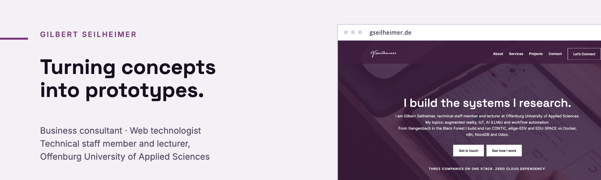

<!-- README-TOP -->

Owner of the agency [**CONTIC**](https://contic.de?mtm_source=github&mtm_medium=profil) (Gengenbach, Black Forest) ·
Technical staff member and lecturer at [**Offenburg University of Applied Sciences**](https://www.hs-offenburg.de)

---

## About me

I combine **business consulting** with **applied web and technology development**, from the strategic idea through implementation to rollout. Since 2007 I have run the agency **CONTIC** and help companies introduce Odoo, GLPI and LimeSurvey and build online platforms. I also teach at Offenburg University of Applied Sciences.

Business enquiries go through [**CONTIC**](https://contic.de?mtm_source=github&mtm_medium=profil): CONTIC advises, designs and introduces; ongoing IT operations are provided on request by **eilige-EDV**.

(<a href="#readme-top">back to top</a>)

## Focus areas

- **Consulting & guidance**: business and technology consulting, digitalisation, e-business; accompanying processes and projects
- **Web & e-business**: HTML5, e-commerce, online platforms, prototyping; AI-assisted deployments and migrations in the web tech stack
- **Platforms & systems**: introduction, integration and migration of Odoo (ERP), GLPI (IT service & asset management), LimeSurvey, REDAXO, WordPress and OXID eShop
- **Innovation**: augmented reality (mobile), IoT and smart factory; AI-assisted, spec-driven development and teaching
- **IT operations**: servers, desktops, support, provided by eilige-EDV, the IT operations side of CONTIC

→ Offering and services: [**contic.de**](https://contic.de?mtm_source=github&mtm_medium=profil)

(<a href="#readme-top">back to top</a>)

## Tech stack & tools

(<a href="#readme-top">back to top</a>)

## Current projects

| Project | What it is about |
| ------- | ---------------- |
| [**ki-projekt-template**](https://github.com/edu-space-de/ki-projekt-template) | Template for AI-assisted student projects (context-/spec-driven development with Claude Code, Cursor, Copilot, Codex), Offenburg University of Applied Sciences |
| **AI-assisted deployments & migrations** | Automated, AI-supported deployments and migrations in the web tech stack |
| **Platform rollouts** | Process- and project-supporting introduction of Odoo, GLPI and LimeSurvey |
| **contic.de** | Editorial restructuring and positioning of the agency website (WordPress / Astra · Spectra) |
| **Newsletter automation** | Automated content pipeline with n8n + LLM + NocoDB |

> **Note:** Only the tip of the iceberg is public here. Most of my work happens in private client and consulting projects. Details, references and code [on request](https://contic.de?mtm_source=github&mtm_medium=profil).

(<a href="#readme-top">back to top</a>)

## Open source & community

Active in the **[REDAXO](https://redaxo.org)** community since 2012, member of
**[FriendsOfREDAXO](https://github.com/FriendsOfREDAXO)**: author of the add-ons
[LightGallery](https://github.com/FriendsOfREDAXO/lightgallery) and
[PhotoSwipe](https://github.com/FriendsOfREDAXO/photoswipe). Earlier add-ons for
REDAXO 4 (MarkItUp, FancyBox, Piwik, Video.js) are archived.

**Contributions:** bug reports, feature requests and pull requests for projects I use
myself, among them Nextcloud (Appointments, Whiteboard, Guests) and the
Odoo localization for Germany (OCA).

(<a href="#readme-top">back to top</a>)

## Teaching and applied research

Technical staff member and lecturer at **Offenburg University of Applied Sciences**, teaching
IT fundamentals, mobile business, mobile commerce and e-commerce.
My topics: augmented reality, IoT, AI (LLMs) and workflow automation. I build the systems I research.
Current focus: AI-assisted, spec-driven development in student team projects.

ORCID: [0009-0002-7613-8260](https://orcid.org/0009-0002-7613-8260)

(<a href="#readme-top">back to top</a>)

## Where to find what

| Account | What you find there |
| ------- | ------------------- |
| [**gseilheimer**](https://github.com/gseilheimer) (here) | Contributions and forks in projects I use (REDAXO, Nextcloud, OCA), personal repositories |
| [**contic-de**](https://github.com/contic-de) | Tools from consulting and IT, by CONTIC |
| [**edu-space-de**](https://github.com/edu-space-de) | Teaching and training material for participants and students, by EDU-SPACE |

(<a href="#readme-top">back to top</a>)

## Contact

- Website: <https://gseilheimer.de?mtm_source=github&mtm_medium=profil>
- Agency: <https://contic.de?mtm_source=github&mtm_medium=profil>
- LinkedIn: [in/gseilheimer](https://www.linkedin.com/in/gseilheimer)
- Portfolio: [Dribbble](https://dribbble.com/gseilheimer) · [Behance](https://www.behance.net/gseilheimer)

---

<strong>Zusammenfassung auf Deutsch</strong>

 

**Gilbert Seilheimer**: aus Konzepten werden Prototypen.

Unternehmensberater, technischer Mitarbeiter und Dozent an der **Hochschule Offenburg** und Inhaber der Agentur **[CONTIC](https://contic.de?mtm_source=github&mtm_medium=profil)** (Gengenbach, Schwarzwald, gegründet 2007). Geschäftliche Anfragen laufen über CONTIC: CONTIC berät, konzipiert und führt ein; den laufenden Betrieb in der IT übernimmt auf Wunsch **eilige-EDV**.

[gseilheimer.de](https://gseilheimer.de?mtm_source=github&mtm_medium=profil) · [LinkedIn](https://www.linkedin.com/in/gseilheimer) · [ORCID](https://orcid.org/0009-0002-7613-8260)

(<a href="#readme-top">back to top</a>)

